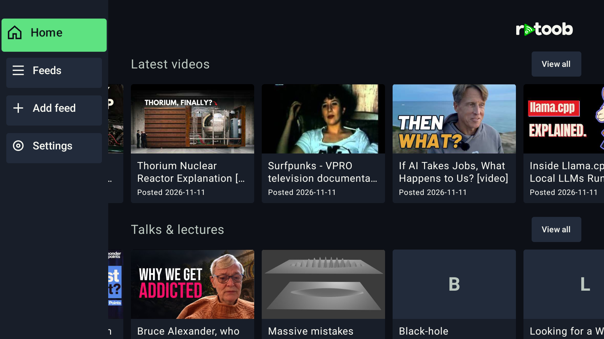
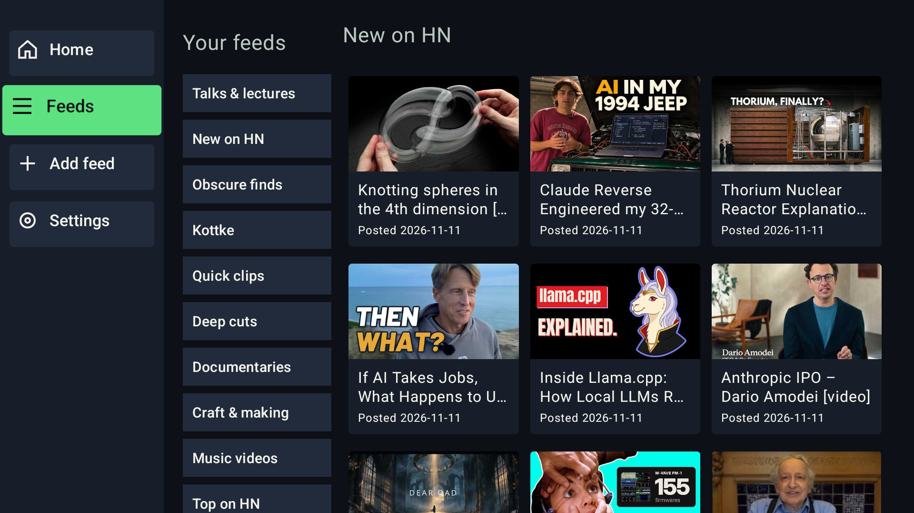

# Retoob TV

**Your video feeds. Your TV.**

Retoob is a video-feed viewer for **Android TV and Google TV**. Browse community-curated videos from across the web, follow the feeds you care about, and watch them from a remote-friendly interface. Your subscriptions are based on public, portable feeds rather than a single centralized video list.

**[Download Retoob TV 0.5.0 preview 2 (APK)](https://github.com/josephgardner/retoob-feeds/releases/download/tv-v0.5.0-preview.2/retoob-tv-0.5.0-preview.2.apk)** · [Release notes and checksums](https://github.com/josephgardner/retoob-feeds/releases/tag/tv-v0.5.0-preview.2) · [Browse public feeds](https://algoplay.com/retoob-feeds/)

> **Preview:** Retoob is currently distributed here as an Android TV APK for sideloading. This repository contains the public feeds, publishing tools, documentation, and TV releases; the Android app's source is maintained separately.

## Screenshots

Two real 1920×1080 captures from an Android TV emulator:

| Home — browse video shelves | Feeds — explore individual lists |
| --- | --- |
|  |  |

## Install on Android TV / Google TV

1. [Download the preview APK](https://github.com/josephgardner/retoob-feeds/releases/download/tv-v0.5.0-preview.2/retoob-tv-0.5.0-preview.2.apk).
2. Transfer the APK to your TV and open it with a file manager that can install APKs. If prompted, allow installation from that app in your TV's **Install unknown apps** settings. The exact menu names vary by device.
3. Install and launch **Retoob**.

**With ADB:** If your TV or emulator is connected and listed by `adb devices`, install from the folder containing the APK:

```sh
adb install -r retoob-tv-0.5.0-preview.2.apk
```

The release page also offers `SHA256SUMS` to verify the downloaded file.

## Get started

1. **Home:** Browse video shelves from your feeds. Choose **View all** to explore more.
2. **Feeds:** Open a particular feed and browse its video grid.
3. **Add feed:** Subscribe to a public feed URL or a directory of feeds. For example:
   - **Feed directory:** `https://algoplay.com/retoob-feeds/feeds.json`
   - **Single feed:** `https://algoplay.com/retoob-feeds/tech-night/feed.json`
4. **Settings:** Manage subscriptions, hide or restore feeds, and check for updates.

The Algoplay collection is included on new installations, so you can start browsing without setting up a publisher. Use your TV remote to navigate and select a video. Playback depends on the source and supported playback handlers on your device.

## How Retoob works

```text
Communities / curators / source APIs
                  |
        Publishers and connectors
                  |
        Public JSON video feeds
             or directories
                  |
              Retoob TV
```

Retoob consumes standardized JSON feeds hosted over HTTP. You can hand-curate a list, generate one from an existing community, or publish a collection of feeds. A Retoob account, central backend, or database is **not** required to publish a feed.

Want to look around? [Explore the public directory](https://algoplay.com/retoob-feeds/), including [Hacker News videos](https://algoplay.com/retoob-feeds/hn-new-videos/feed.json) and [HackerTube catalogue videos](https://algoplay.com/retoob-feeds/hackertube-software/feed.json).

## Make your own feed

This repository also hosts the **public feed-publishing companion** to Retoob TV. The protocol uses JSON Feed 1.1 with the Retoob profile-1 schema, alongside an optional directory schema.

- [Feed schema](docs/schemas/retoob-feed-v1.schema.json)
- [Directory schema](docs/schemas/retoob-directory-v1.schema.json)
- [Manual/static publisher example](examples/static-publisher/)
- [Hacker News connector example](examples/hn-publisher/)
- [Publishing and connector guide](PUBLISHING.md) — all the original technical README content, including source credits, state handling, deployment, and conformance notes

**Repository scope:** `retoob-feeds` publishes public feed data, documentation, and Retoob TV APK releases. It is not the app source repository.
